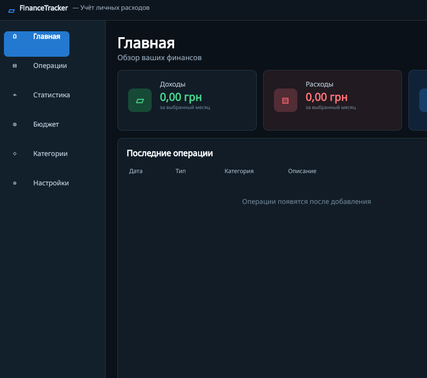

# FinanceTracker

Настольное приложение для учёта личных доходов и расходов.



## Быстрая установка

Готовые сборки находятся на странице [Releases](https://github.com/laisyktop4ik-star/FinanceTracker/releases/latest).

### Linux x64

1. Скачайте `FinanceTracker-1.1.0-linux-x64.tar.gz`.
2. Распакуйте архив полностью.
3. Откройте терминал в распакованной папке и выполните:

```bash
chmod +x install.sh
./install.sh
```

FinanceTracker появится в меню приложений. `sudo` и отдельная установка .NET не нужны.

### Windows x64

1. Скачайте `FinanceTracker-1.1.0-windows-x64.zip`.
2. Распакуйте ZIP в отдельную папку.
3. Запустите `FinanceTracker.exe`.

> Linux-сборка полностью проверена. Windows-сборка создаётся кросс-компиляцией и требует дополнительной проверки на Windows.

## Стек

- C# и .NET 8 LTS
- Avalonia UI 11
- SQLite (`Microsoft.Data.Sqlite`)
- MVVM (`CommunityToolkit.Mvvm`)
- xUnit

## Возможности

- добавление, редактирование и удаление операций;
- подтверждение перед удалением;
- доходы, расходы и автоматический расчёт баланса;
- фильтрация по месяцу и типу, поиск по категории и описанию;
- график динамики доходов и расходов за 6 месяцев;
- статистика расходов по категориям;
- месячный бюджет и индикатор использования;
- пользовательские категории;
- выбор обозначения валюты;
- пользовательское фоновое изображение с регулировкой яркости;
- экспорт истории в CSV;
- создание и восстановление резервных копий SQLite;
- локальная работа без браузера и интернета.

## Структура

```text
src/FinanceTracker.App   — интерфейс и ViewModel
src/FinanceTracker.Core  — модели, деньги и расчёты
src/FinanceTracker.Data  — SQLite и репозиторий
tests/FinanceTracker.Tests — автоматические тесты
```

## Сборка и тесты

```bash
export PATH="$HOME/.dotnet:$PATH"
dotnet restore
dotnet test
dotnet build -c Release
```

## Self-contained публикация для Linux

```bash
dotnet publish src/FinanceTracker.App \
  -c Release \
  -r linux-x64 \
  --self-contained true \
  -o publish/linux-x64
```

## Данные

Основная база:

```text
~/.local/share/FinanceTracker/finance.db
```

Резервные копии:

```text
~/Documents/FinanceTracker Backups/
```

Реальная база пользователя не должна публиковаться в GitHub.
